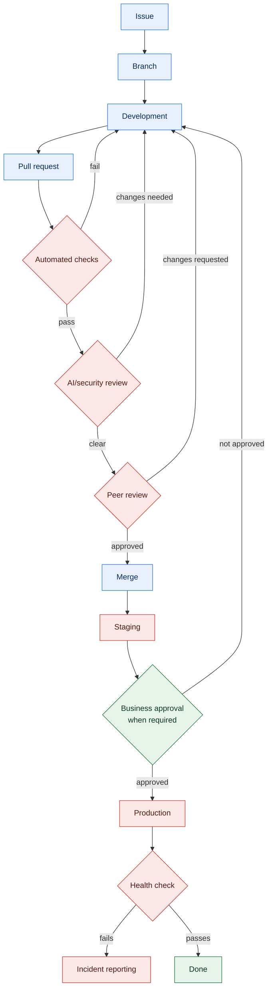

# Engineering Workflow

The canonical path from idea to production. Every change follows it.

Who acts: **blue** developer · **red** technical admin and automation ·
**green** business approver. Every arrow back to Development is a normal outcome,
not a failure — the only path that skips a stage is
[exceptions](#exceptions), and it compresses review rather than skipping it.

## Stages

**Issue** — All work starts as a GitHub issue with the intended outcome and acceptance criteria.
No issue, no branch.

**Branch** — Cut from the default branch. Name it `<type>/<issue-number>-<slug>`
(e.g. `fix/412-token-refresh`). Types: `feat`, `fix`, `chore`, `docs`, `refactor`, `test`.

**Development** — Use whatever IDE and language the project calls for. Commit in small,
reviewable increments. Never commit secrets ([secrets handling](../security/secrets-handling.md)).

**Pull request** — Opened against the default branch, linked to its issue.
Requirements in the [pull request policy](../policies/pull-request-policy.md).

**Automated checks** — CI must be green: tests, linters and policy checks.
Fix the code, not the test, unless the test is wrong.

**AI/security review** — Automated review, where configured, supplements human review and
never replaces it
([AI-assisted development](../policies/ai-assisted-development.md#ai-review-supplements-human-review)).
Security-sensitive areas additionally require technical-admin review.

**Peer review** — At least one approving human review from someone other than the author.

**Merge** — Author merges after all gates pass. Squash by default. Delete the branch.

**Staging** — Deploys automatically from the default branch. Verify the change here.

**Business approval** — Required for the cases listed in
[release process](release-process.md#business-approval-is-required-when), given by a
[Business Approver](release-process.md#who-approves). Recorded in writing.

**Production** — Deployed through the pipeline only. No manual changes when a pipeline exists.

**Health check** — Confirm health after deploy and record the result on the PR or release.
If it fails, follow [incident reporting](../security/incident-reporting.md).

## Exceptions

Emergency fixes compress review; they never skip it.

1. Open a stub issue first — one line is enough. The branch and the PR both need it;
   CI enforces the link on the PR, the branch name is on you.
2. Open the PR and get one approving review. If the change is security-sensitive
   (see [pull request policy](../policies/pull-request-policy.md#additional-review-requirements)),
   that reviewer must be a technical admin.
3. Deploy through the pipeline.
4. Within one business day: flesh out the issue, add the missing tests, and record the
   exception and its reason on the PR.

Nothing here authorizes a manual production change — see
[release process](release-process.md#environments-without-a-pipeline).
